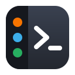
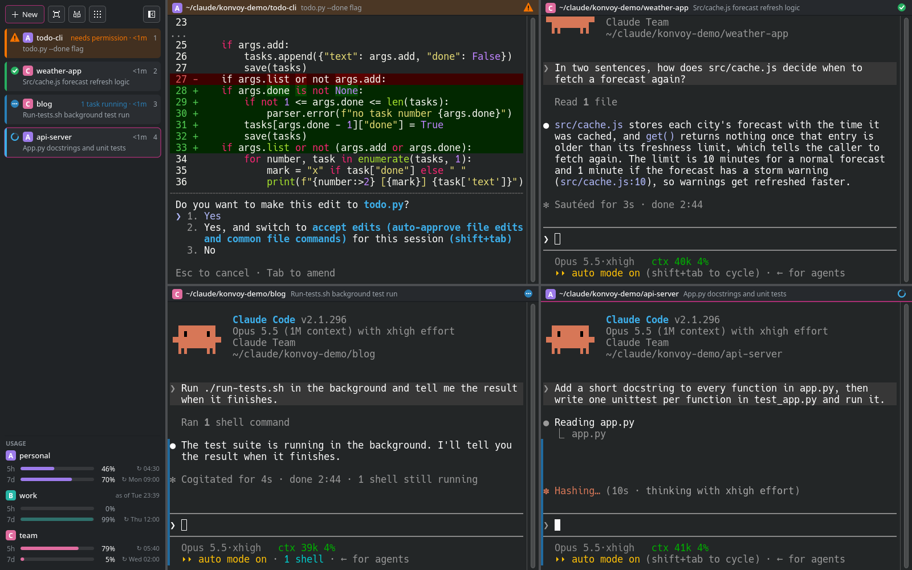
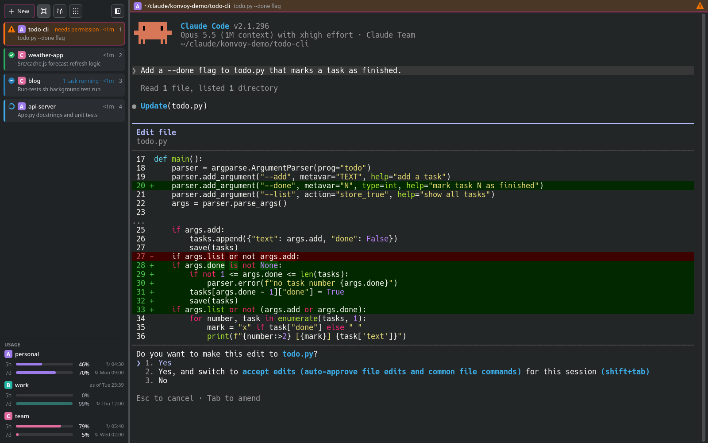
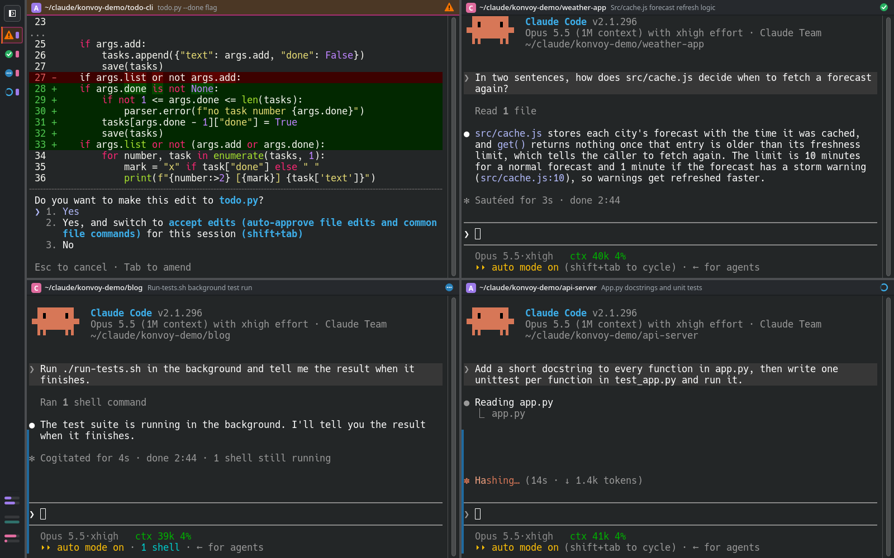

<h1> Konvoy</h1>

Konvoy runs several Claude Code sessions side by side in one KDE window. Every
session is a real Konsole terminal, and a slim sidebar shows which one is at
work, which one waits for you and which one is done. Below that it shows how
much of the 5 hour and 7 day limits each of your Claude accounts has used and
when they reset.

I made Konvoy mainly for my own use, so it follows the way I work. It is shared
as it is, in case it helps someone else.



*One session asks for a permission, one is done, one has its tests running in
the background and one is still at work.*

## Features

* Real Konsole terminals that run the unchanged `claude`, so everything Claude
  Code does works as usual
* A card per session in the sidebar with its state, whether it works, waits
  for a permission or an answer, is done, still has tasks running in the
  background or has ended
* A session only looks selected while your typing goes into it. A click on the
  sidebar's empty space deselects them all, so one that finishes in plain
  sight still shows done
* A notification when a session out of sight needs you
* A number on Konvoy's taskbar icon counts the sessions that are done or wait
  for you
* Several Claude accounts side by side, each in its own colour. Every new
  session asks which account to use
* The 5 hour and 7 day usage of every account with its reset times. A click on
  a reset time shows the time left instead
* Focus mode shows one session big while the sidebar keeps an eye on the rest
* Press and hold a card to move its session, or drag a session's header onto
  another one to swap the two
* The sidebar can shrink to a slim strip that still shows every state
* After a restart every session comes back in its place and continues its chat
* A new session starts fresh or continues one of the recent chats in its folder
* `Alt+1` to `Alt+9` jump to a session, `Ctrl+Shift+T` opens a new one,
  `Ctrl+Shift+E` turns focus mode on and off and `Ctrl+Shift` with the arrow
  keys moves the current session around

<p>


</p>

*Focus mode, and the sidebar shrunk to a strip.*

## Install

Konvoy needs Claude Code, KDE Frameworks 6 with Konsole, CMake and extra cmake
modules to build, and bash and Python 3 for its helpers.

```sh
git clone https://github.com/Tobias2909/Konvoy.git
cd Konvoy
cmake -B build -DCMAKE_INSTALL_PREFIX=~/.local
cmake --build build
cmake --install build
cp konvoyrc.example ~/.config/konvoyrc
```

Then list your accounts in `~/.config/konvoyrc`. The example explains every
line, and one account is enough. Last, Konvoy adds its hooks to the Claude Code
settings of every account in your config. They tell Konvoy what each session
is doing. It shows them before it writes, and your other hooks stay as they are.

```sh
konvoy --install-hooks
```

Konvoy now sits in your application menu. `konvoy --remove-hooks` takes the
hooks out again.

Konvoy sends no requests of its own. The usage numbers are the ones Claude Code
hands to its status line after every answer. To pass them on, add these two
lines to your status line script.

```sh
input=$(cat)
printf '%s' "$input" | ~/.local/lib/libexec/konvoy-statusline
```

Without a status line of your own, `~/.local/lib/libexec/konvoy-statusline` can
be the whole status line command. It prints nothing. An account without an
open session shows the numbers Claude Code saved last, dimmed and with their
time.

## Not an official anything

Konvoy is one person's own program and is not made by, endorsed by or
connected to Anthropic. Claude and Claude Code are Anthropic's.

## License

MIT. See [LICENSE](LICENSE).
